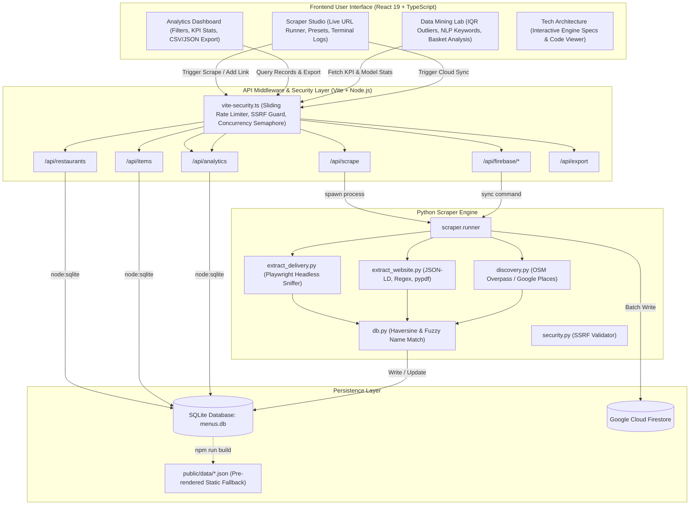

# GrabFood & Restaurant Data Scraper

[](https://react.dev/)
[](https://www.typescriptlang.org/)
[](https://vitejs.dev/)
[](https://www.python.org/)
[](https://playwright.dev/)
[](https://www.sqlite.org/)
[](https://firebase.google.com/)
[](https://github.com/ElXprogramming/Grabfood-Data-Scraper)
[](https://github.com/ElXprogramming/Grabfood-Data-Scraper)
[](LICENSE)

> **An end-to-end restaurant venue discovery, headless delivery & web menu extraction engine, and computational data mining laboratory.**

A high-performance restaurant intelligence platform engineered to map local dining ecosystems, extract rich menu datasets from food delivery apps and official websites, and provide actionable analytics. It handles everything from automated venue discovery, headless browser menu scraping, and fuzzy geospatial deduplication to hybrid SQLite/Firestore persistence, real-time analytics, and advanced computational data mining.

---

## Table of Contents

- [Key Features](#key-features)
- [How the System Works](#how-the-system-works)
  - [Architecture Overview](#architecture-overview)
  - [The 5-Stage Scraping & Intelligence Pipeline](#the-5-stage-scraping--intelligence-pipeline)
  - [Fuzzy Deduplication & Spatial Normalization](#fuzzy-deduplication--spatial-normalization)
  - [Hybrid Storage & Cloud Synchronization](#hybrid-storage--cloud-synchronization)
- [GrabFood Scraper: Architecture & Implementation](#grabfood-scraper-architecture--implementation)
  - [Why Traditional HTML Scraping Fails on GrabFood](#why-traditional-html-scraping-fails-on-grabfood)
  - [Headless Network Sniffing Mechanics](#headless-network-sniffing-mechanics)
  - [Key Implementation Highlights](#key-implementation-highlights)
  - [Complete Source Code Inspection](#complete-source-code-inspection)
  - [GrabFood Scraping CLI & Tests](#grabfood-scraping-cli--tests)
- [Technologies Used](#technologies-used)
  - [Frontend Layer](#frontend-layer)
  - [Backend & Middleware Layer](#backend--middleware-layer)
  - [Scraper & Data Extraction Engine](#scraper--data-extraction-engine)
  - [Data Persistence & Cloud Services](#data-persistence--cloud-services)
  - [Testing & DevOps](#testing--devops)
- [System Architecture Diagram](#system-architecture-diagram)
- [Project Structure](#project-structure)
- [Getting Started](#getting-started)
  - [Prerequisites](#prerequisites)
  - [1. Clone & Install Frontend Dependencies](#1-clone--install-frontend-dependencies)
  - [2. Configure Python Scraper Virtual Environment](#2-configure-python-scraper-virtual-environment)
  - [3. Configure Environment Variables](#3-configure-environment-variables)
  - [4. Launch the Development Server](#4-launch-the-development-server)
  - [5. Production Build & Static Deployment](#5-production-build--static-deployment)
- [CLI Scraper Usage (Standalone Execution)](#cli-scraper-usage-standalone-execution)
- [REST API Reference](#rest-api-reference)
- [Security Architecture & Rate Limiting Controls](#security-architecture--rate-limiting-controls)
  - [1. Multi-Tiered Rate Limiting & Concurrency Controls](#1-multi-tiered-rate-limiting--concurrency-controls)
  - [2. Server-Side Request Forgery (SSRF) Defense](#2-server-side-request-forgery-ssrf-defense)
  - [3. CLI Argument & Command Injection Defense](#3-cli-argument--command-injection-defense)
  - [4. Payload Size Limits & DoS Prevention](#4-payload-size-limits--dos-prevention)
  - [5. CSV Formula Injection (DDE) Neutralization](#5-csv-formula-injection-dde-neutralization)
  - [6. Defensive HTTP Security Headers](#6-defensive-http-security-headers)
  - [7. Automated Security Test Suites](#7-automated-security-test-suites)
- [License](#license)

---

## Key Features

- **Four Integrated Web Workspaces**:
  - **Scraper Studio**: Interactive runner supporting real-time URL execution, preset sample links, manual venue link association, custom parameter overrides (rating, cuisine, coordinates, opening hours), and live streaming execution logs.
  - **Analytics Dashboard**: Instant faceted dataset exploration with search, multi-field filtering (category, cuisine, rating, price thresholds, district), sorting, KPI summaries, and one-click CSV/JSON exports.
  - **Data Mining Lab**:
    - **Outlier & Anomaly Mining**: Dynamic Interquartile Range (IQR) boxplot threshold calculation and pricing anomaly detection.
    - **Culinary NLP & Text Mining**: Multi-lingual tokenization, stopword filtering, and frequency analysis of menu keywords and flavor profiles.
    - **Market Basket Analysis**: Support and confidence estimation for combo items and cross-category ordering patterns.
    - **Econometric Price Distributions**: Dynamic histogram binning, variance, and standard deviation calculations.
  - **System Architecture Viewer**: Interactive topology diagrams, passive network sniffing breakdowns, and direct code viewer with one-click copy.
- **Headless Delivery Platform Extractor**: Collects menus from delivery applications (GrabFood, foodpanda) using Playwright Chromium headless network interception to extract structured menu data without private API bypasses.
- **Multi-Source Discovery Engine**: Automatically locates food establishments across target geographic coordinates using OpenStreetMap (Overpass API) and Google Places API (New Text Search).
- **Smart Website Parser**: Extracts menus directly from restaurant websites using schema.org `JSON-LD` microdata, regular expressions for price matching (`RM XX.XX`), and text extraction from downloadable PDF menus (`pypdf`).
- **Geospatial & Fuzzy Deduplication**: Merges multi-source entries into a single restaurant entity using Haversine distance (<120m threshold) combined with Levenshtein/`SequenceMatcher` string similarity matching.
- **Hybrid Storage & Cloud Sync**: Local offline-first relational persistence with SQLite 3 (`menus.db`) and on-demand cloud synchronization with Google Cloud Firestore via Firebase Admin SDK.
- **Dual Deployment Modes**: Full-stack dynamic mode (Node.js API + SQLite + Python) and static production mode (pre-exported JSON/CSV dataset with zero-backend client fallback on Netlify).

---

## How the System Works

### Architecture Overview

The system operates as a unified full-stack application. A React + TypeScript single-page application (SPA) communicates with an embedded Node.js API middleware inside Vite. When scraping operations are triggered from the UI, the Node API spawns isolated Python worker processes that execute headless Chromium sessions or polite HTTP crawlers, writes updates to SQLite (`menus.db`), and optionally syncs with Google Cloud Firestore.

```
+-------------------------------------------------------------------------------------------------+
|                                          USER BROWSER                                           |
|    [Scraper Studio]    [Analytics Dashboard]    [Data Mining Lab]    [Architecture Viewer]      |
+-----------------------------------------------+-------------------------------------------------+
                                                | HTTP / JSON REST APIs
                                                v
+-------------------------------------------------------------------------------------------------+
|                                 VITE API MIDDLEWARE (Node.js)                                   |
|   /api/restaurants  |  /api/items  |  /api/analytics  |  /api/scrape  |  /api/export  |  /sync  |
+---------------------------------------+---------------------------------------------------------+
                                        |
              +-------------------------+-------------------------+
              | Reads / Writes SQL                                | Spawns Worker Process
              v                                                   v
+---------------------------+                         +-----------------------------------+
|   SQLite DB (menus.db)    |                         |       PYTHON SCRAPER RUNNER       |
| - restaurants             |                         | - runner.py / cli.py              |
| - menu_items              |<------------------------+ - extract_delivery.py             |
| - menu_assets             |   Atomic Transactions   | - extract_website.py              |
| - scrape_log              |                         | - discovery.py                    |
+---------------------------+                         +-----------------+-----------------+
              ^                                                         |
              | Real-Time Cloud Sync                                    | Headless Browser / HTTP
              v                                                         v
+---------------------------+                         +-----------------------------------+
|  Google Cloud Firestore   |                         |    TARGET WEBSITES & PLATFORMS    |
|  (restaurantdatascraper)  |                         | - GrabFood / foodpanda Pages      |
+---------------------------+                         | - Official Restaurant Sites       |
              ^                                       | - OpenStreetMap / Overpass API    |
              | Static Build Pre-export               | - Google Places API               |
+-------------+-------------+                         +-----------------------------------+
| public/data/*.json / CSV  | (Client Fallback for Netlify / Static Hosting)
+---------------------------+
```

---

### The 5-Stage Scraping & Intelligence Pipeline

#### 1. Discovery Stage
- Scans target bounding coordinates (e.g., 1Borneo Hypermall at `6.0360, 116.1297` and Alamesra at `6.0334, 116.1253`).
- Queries OpenStreetMap via Overpass API for amenities (`restaurant`, `fast_food`, `cafe`, `food_court`, `ice_cream`).
- Optionally queries the Google Places API (New) for extended venue profiles, user ratings, and official website URLs.

#### 2. Extraction Stage
- **Delivery Platforms (GrabFood & foodpanda)**: Opens target links in headless Chromium via Playwright. Listens to asynchronous network payloads (`XHR`/`fetch`), decodes internal JSON catalog structures, and recursively walks data nodes searching for name, price, and category containers.
- **Restaurant Websites**:
  1. Checks for structured schema.org `JSON-LD` markup (`Menu`, `MenuSection`, `MenuItem`).
  2. Fallback heuristic parsing: searches HTML text and downloadable PDF documents for Malaysian Ringgit currency patterns (`RM 12.90`, `MYR 8.50`).
  3. Image menus (scanned photos/flyers) are archived into `menu_assets` for optical character recognition (OCR) or manual audit.

#### 3. Deduplication & Spatial Normalization
- When a new restaurant is discovered or added, the engine prevents duplicate records:
  - Calculates the **Haversine great-circle distance** between coordinate pairs.
  - Compares venue titles with **fuzzy string similarity** (`SequenceMatcher`).
  - If a venue is within **120 meters** and has a name similarity ratio above **0.80**, records are merged rather than duplicated, preserving both direct website and delivery links.

#### 4. Full-Stack API & Integration Stage
- `vite-plugin-api.ts` intercepts `/api/*` HTTP calls directly in the Vite development and preview server.
- Uses Node.js native `node:sqlite` (`DatabaseSync`) for zero-overhead, synchronous SQL queries.
- Dynamically executes Python CLI tasks via `child_process.spawn`, piping structured stdout JSON back to the frontend.
- Guards endpoints with multi-tier rate limiting and security policies (`vite-security.ts`).

#### 5. Analytics & Computational Data Mining Stage
- Raw database records are aggregated into actionable business intelligence:
  - **KPIs**: Mean, median, minimum, maximum, variance, and standard deviation of menu prices.
  - **Outlier Detection**: Calculates lower and upper fences using the formula:
    $$\text{Lower Bound} = \max(0, Q_1 - k \times \text{IQR}), \quad \text{Upper Bound} = Q_3 + k \times \text{IQR}$$
    where $k$ is an adjustable multiplier (default 1.5).
  - **Culinary NLP**: Tokenizes item titles, removes multi-lingual stop words (`set`, `with`, `dan`, `ala`, `carte`), and extracts top dish themes and flavor profiles.

---

### Fuzzy Deduplication & Spatial Normalization

Restaurants often appear under slightly different names across different services (e.g., *"Subway - 1Borneo"* on GrabFood vs *"Subway Restaurants"* on Google Places). The database engine uses the following deduplication logic:

1. **Exact Identifier Match**: Matches unique OSM IDs (`node/12345`) or Google Place IDs.
2. **Spatial Proximity & String Similarity**:
   - Compares physical proximity using coordinates:
     $$d = 2R \arcsin\left(\sqrt{\sin^2\left(\frac{\Delta \phi}{2}\right) + \cos(\phi_1)\cos(\phi_2)\sin^2\left(\frac{\Delta \lambda}{2}\right)}\right)$$
   - If distance $d \le 120\text{ m}$ and name similarity ratio $\ge 0.80$, the existing record is updated with any newly discovered URLs or coordinates.
3. **Menu Item Replacement**: When a restaurant is rescraped from the same source, existing menu items for that specific source are refreshed to prevent duplicate entries while preserving items scraped from complementary platforms.

---

### Hybrid Storage & Cloud Synchronization

- **Local Storage (`menus.db`)**:
  - Relational SQLite database with foreign keys enabled.
  - Tables: `restaurants`, `menu_items`, `menu_assets`, `scrape_log`.
  - Ensures full offline functionality and fast analytical queries.
- **Cloud Database (Google Cloud Firestore)**:
  - Document collections: `restaurants` and `menu_items`.
  - Authenticated through Google Cloud Service Account credentials (`GOOGLE_APPLICATION_CREDENTIALS` or `credentials/serviceAccountKey.json`).
  - Synchronized on demand from the Scraper Studio UI or via CLI:
    ```bash
    PYTHONPATH=scraper scraper/.venv/bin/python -m scraper.runner --sync-firebase
    ```

---

## GrabFood Scraper: Architecture & Implementation

The GrabFood scraper is engineered to extract full restaurant menus, categorizations, pricing, and establishment metadata from GrabFood storefronts (`https://food.grab.com/my/en/restaurant/...`).

### Why Traditional HTML Scraping Fails on GrabFood
- **Client-Side Rendering**: GrabFood is built on Next.js/React. HTML served to raw HTTP clients (like `curl` or `requests`) contains only empty container shells and JavaScript hydration bundles, with zero menu items in the initial DOM.
- **Dynamic Asynchronous JSON APIs**: As the page boots, client-side scripts query internal Grab endpoints (e.g., merchant catalog endpoints) that transmit nested JSON payloads containing all sections, categories, products, and modifier options.
- **Regional Geolocation Enforcement**: Grab checks user coordinates and locales. Missing or foreign coordinates cause pages to return empty menus or redirect to landing pages.

### Headless Network Sniffing Mechanics
To overcome these obstacles without brittle DOM selectors or reverse-engineering private authentication schemes, the scraper employs **Passive Network Interception**:

```
+-----------------------------------------------------------------------------------------+
|                                    GRABFOOD SCRAPER FLOW                                |
+-----------------------------------------------------------------------------------------+
|                                                                                         |
|  1. Headless Browser Initialization (browser.py)                                        |
|     - Spawns Playwright Chromium in headless context                                    |
|     - Sets Malaysian locale: 'en-MY'                                                    |
|     - Injects Sabah coordinates: lat 6.0360, lon 116.1297 (1Borneo / Kota Kinabalu)     |
|     - Grants geolocation permissions to bypass regional delivery barriers               |
|                                                                                         |
|  2. Passive Network Sniffing & Response Interception                                    |
|     - Listens via page.on('response', on_response)                                      |
|     - Catches all HTTP 200 responses with 'Content-Type: application/json'              |
|     - Appends captured JSON bodies into payloads buffer                                 |
|                                                                                         |
|  3. Next.js Hydration Fallback Extraction                                               |
|     - BeautifulSoup scans rendered HTML for <script id="__NEXT_DATA__">                 |
|     - Parses embedded state if background API calls are throttled                       |
|                                                                                         |
|  4. Recursive Catalog Tree Walker (_walk & _to_price)                                   |
|     - Traverses nested categories, subCategories, sections, and items                   |
|     - Normalizes prices: converts priceInMinorUnit (cents) / 100 -> MYR float           |
|     - Prioritizes promotional & discountedPrice over base price                         |
|     - Extracts item name, description, category, and currency                           |
|                                                                                         |
|  5. Restaurant Metadata Parsing (extract_metadata_from_payloads)                        |
|     - Extracts star rating: ratingScore / vendorRating.value                            |
|     - Extracts cuisine tags: cuisine / cuisineTags / foodTypes                          |
|     - Extracts operating hours: openingHours / displayedHours / schedules               |
|     - Extracts physical street address & exact latitude/longitude coordinates           |
|                                                                                         |
|  6. Storage & Deduplication                                                             |
|     - Deduplicates against existing venues using Haversine (<120m) & string similarity  |
|     - Atomically writes to SQLite (menus.db) and Google Cloud Firestore                |
|                                                                                         |
+-----------------------------------------------------------------------------------------+
```

---

### Key Implementation Highlights

#### 1. Playwright Headless Browser Sniffer (`browser.py`)
Spoofs Malaysian coordinates to bypass GrabFood's delivery barrier and passively collects all background JSON payloads:

```python
def capture(url: str, wait_ms: int = 4000):
    """Load `url` in Chromium, inject regional coordinates, and sniff background JSON."""
    payloads = []
    with sync_playwright() as p:
        browser = p.chromium.launch(headless=True)
        try:
            ctx = browser.new_context(
                user_agent=config.USER_AGENT,
                locale="en-MY",
                geolocation={"latitude": 6.0360, "longitude": 116.1297},
                permissions=["geolocation"],
            )
            page = ctx.new_page()

            def on_response(resp):
                try:
                    if "json" in (resp.headers.get("content-type") or "") and resp.status == 200:
                        payloads.append(resp.json())
                except Exception:
                    pass

            page.on("response", on_response)
            page.goto(url, wait_until="domcontentloaded", timeout=45000)
            page.wait_for_timeout(wait_ms)
            html = page.content()
        finally:
            browser.close()
    return html, payloads
```

#### 2. Recursive Catalog Tree Walker & Price Normalization (`extract_delivery.py`)
Recursively walks nested JSON data structures regardless of variations between GrabFood and foodpanda, normalizing minor units (cents) to Malaysian Ringgit:

```python
PRICE_KEYS = (
    ("discountedPrice", 1),
    ("discount_price", 1),
    ("priceInMinorUnit", 100),    # GrabFood uses minor units (cents)
    ("price_in_minor_unit", 100),
    ("price", 1),
    ("displayPrice", 1),
)

def _to_price(d: Dict[str, Any]) -> Optional[float]:
    """Extract and normalize numerical price, converting cents to Ringgit (MYR)."""
    for key, div in PRICE_KEYS:
        v = d.get(key)
        if isinstance(v, dict):
            v = v.get("amount") or v.get("value") or v.get("price")
        if isinstance(v, str):
            v = "".join(c for c in v if c.isdigit() or c == ".") or None
        try:
            f = float(v) / div
            if 0 < f < 2000:
                return round(f, 2)
        except (TypeError, ValueError):
            continue
    return None

def _walk(node: Any, category: Optional[str], out: List[Dict[str, Any]]) -> None:
    """Recursively walk payload JSON nodes to collect categorized menu items."""
    if isinstance(node, list):
        for n in node:
            _walk(n, category, out)
    elif isinstance(node, dict):
        children = next((node[k] for k in CHILD_KEYS if isinstance(node.get(k), list)), None)
        if children is not None:
            cat_name = _name(node)
            current_cat = cat_name if cat_name and cat_name.lower() not in ("menu", "categories") else category
            for c in children:
                _walk(c, current_cat, out)
        else:
            name, price = _name(node), _to_price(node)
            if name and price is not None:
                desc = next((str(node[k]).strip() for k in DESC_KEYS if isinstance(node.get(k), str) and node[k].strip()), None)
                out.append({
                    "category": category or "General",
                    "name": name,
                    "description": desc,
                    "price": price,
                    "currency": "MYR",
                })
```

---

### Complete Source Code Inspection

The complete, unmodified Python extractor and headless browser modules are available in the repository:
- **Catalog & Metadata Extractor**: [`scraper/scraper/extract_delivery.py`](scraper/scraper/extract_delivery.py)
- **Playwright Headless Browser Sniffer**: [`scraper/scraper/browser.py`](scraper/scraper/browser.py)
- **Interactive UI Architecture Viewer**: Available directly in the web app under the **System Architecture** tab (`src/components/TechArchitecture.tsx`).

<details>
<summary><b>🔍 Click to expand full source code of <code>browser.py</code> (43 lines)</b></summary>

```python
"""Headless-browser helper (Playwright). Used for JS-rendered sites and delivery apps.

Setup once:  pip install playwright && playwright install chromium
"""
from . import config


def capture(url: str, wait_ms: int = 4000):
    """Load `url` in Chromium. Returns (rendered_html, [json_payloads]) where the payloads are
    every JSON response the page fetched in the background - menus usually travel this way."""
    from playwright.sync_api import sync_playwright

    payloads = []
    with sync_playwright() as p:
        browser = p.chromium.launch(headless=True)
        try:
            ctx = browser.new_context(
                user_agent=config.USER_AGENT,
                locale="en-MY",
                geolocation={"latitude": 6.0360, "longitude": 116.1297},
                permissions=["geolocation"],
            )
            page = ctx.new_page()

            def on_response(resp):
                try:
                    if "json" in (resp.headers.get("content-type") or "") and resp.status == 200:
                        payloads.append(resp.json())
                except Exception:
                    pass

            page.on("response", on_response)
            page.goto(url, wait_until="domcontentloaded", timeout=45000)
            try:
                page.wait_for_load_state("networkidle", timeout=12000)
            except Exception:
                pass
            page.wait_for_timeout(wait_ms)
            html = page.content()
        finally:
            browser.close()
    return html, payloads
```

</details>

<details>
<summary><b>🔍 Click to expand full source code of <code>extract_delivery.py</code> (367 lines)</b></summary>

```python
"""Stage 2b - Extractor for delivery-platform pages (GrabFood, Foodpanda).

These apps load menus through background JSON calls. We open a restaurant page in a
headless browser, capture network JSON responses, and walk them to extract structured
menu items (category, name, price, description) and restaurant metadata.
"""
from __future__ import annotations

import json
import re
from typing import Any, Dict, List, Optional, Tuple

from bs4 import BeautifulSoup

from .browser import capture


NAME_KEYS = ("name", "title", "itemName", "item_name", "productName", "dishName")
DESC_KEYS = ("description", "desc", "itemDescription", "item_description", "summary")
PRICE_KEYS: Tuple[Tuple[str, float], ...] = (
    ("discountedPrice", 1),
    ("discount_price", 1),
    ("priceInMinorUnit", 100),
    ("price_in_minor_unit", 100),
    ("price", 1),
    ("displayPrice", 1),
    ("unitPrice", 1),
    ("unit_price", 1),
    ("amount", 1),
)
CHILD_KEYS = ("items", "dishes", "products", "menuItems", "menu_items", "foods", "subCategories", "sections", "categories")
VARIATION_KEYS = ("variations", "variants", "productVariations", "product_variations", "options")


def _to_price(d: Dict[str, Any]) -> Optional[float]:
    """Extract and normalize numerical price from a dictionary or its variations."""
    for key, div in PRICE_KEYS:
        v = d.get(key)
        if isinstance(v, dict):
            v = v.get("amount") or v.get("value") or v.get("price")
        if isinstance(v, str):
            v = "".join(c for c in v if c.isdigit() or c == ".") or None
        try:
            f = float(v) / div
            if 0 < f < 2000:
                return round(f, 2)
        except (TypeError, ValueError):
            continue

    # Fallback: check nested product variations (common in Foodpanda & modern delivery APIs)
    for var_key in VARIATION_KEYS:
        vars_list = d.get(var_key)
        if isinstance(vars_list, list) and vars_list:
            for item in vars_list:
                if isinstance(item, dict):
                    price = _to_price(item)
                    if price is not None:
                        return price
    return None


def _name(d: Dict[str, Any]) -> Optional[str]:
    """Extract a valid item or category name string."""
    for k in NAME_KEYS:
        val = d.get(k)
        if isinstance(val, str) and 1 < len(val.strip()) < 120:
            return val.strip()
    return None


def _walk(node: Any, category: Optional[str], out: List[Dict[str, Any]]) -> None:
    """Recursively walk payload JSON nodes to collect category menu items."""
    if isinstance(node, list):
        for n in node:
            _walk(n, category, out)
    elif isinstance(node, dict):
        children = next((node[k] for k in CHILD_KEYS if isinstance(node.get(k), list)), None)
        if children is not None:
            cat_name = _name(node)
            current_cat = cat_name if cat_name and cat_name.lower() not in ("menu", "categories") else category
            for c in children:
                _walk(c, current_cat, out)
            for k, v in node.items():
                if k not in CHILD_KEYS and isinstance(v, (dict, list)):
                    _walk(v, current_cat, out)
        else:
            name, price = _name(node), _to_price(node)
            if name and price is not None:
                desc = next(
                    (str(node[k]).strip() for k in DESC_KEYS if isinstance(node.get(k), str) and node[k].strip()),
                    None,
                )
                out.append({
                    "category": category or "General",
                    "name": name,
                    "description": desc,
                    "price": price,
                    "currency": "MYR",
                })
            else:
                for v in node.values():
                    if isinstance(v, (dict, list)):
                        _walk(v, category, out)


def _extract_meta_from_jsonld(html: str) -> Dict[str, Any]:
    """Parse JSON-LD restaurant metadata from HTML if available."""
    meta: Dict[str, Any] = {}
    if not html:
        return meta

    try:
        soup = BeautifulSoup(html, "html.parser")
        for s in soup.find_all("script", type="application/ld+json"):
            try:
                data = json.loads(s.string or "{}")
                nodes = data if isinstance(data, list) else [data]
                for node in nodes:
                    if not isinstance(node, dict):
                        continue
                    types = node.get("@type", "")
                    types_list = [str(t).lower() for t in (types if isinstance(types, list) else [types])]
                    if any(t in types_list for t in ("restaurant", "foodestablishment", "localbusiness", "cafe", "fastfoodrestaurant")):
                        if node.get("name") and not meta.get("name"):
                            meta["name"] = str(node["name"]).strip()
                        if node.get("aggregateRating") and meta.get("rating") is None:
                            ar = node["aggregateRating"]
                            val = ar.get("ratingValue") if isinstance(ar, dict) else ar
                            if val is not None:
                                try:
                                    meta["rating"] = round(float(val), 1)
                                except (TypeError, ValueError):
                                    pass
                        if node.get("servesCuisine") and not meta.get("cuisine"):
                            c = node["servesCuisine"]
                            meta["cuisine"] = ", ".join(c) if isinstance(c, list) else str(c).strip()
                        if node.get("address") and not meta.get("address"):
                            addr = node["address"]
                            if isinstance(addr, dict):
                                parts = [addr.get("streetAddress"), addr.get("addressLocality"), addr.get("postalCode")]
                                meta["address"] = ", ".join(str(p).strip() for p in parts if p)
                            elif isinstance(addr, str):
                                meta["address"] = addr.strip()
                        if node.get("geo") and (meta.get("lat") is None or meta.get("lon") is None):
                            geo = node["geo"]
                            if isinstance(geo, dict):
                                try:
                                    meta["lat"] = round(float(geo.get("latitude")), 6)
                                    meta["lon"] = round(float(geo.get("longitude")), 6)
                                except (TypeError, ValueError):
                                    pass
                        if node.get("openingHoursSpecification") and not meta.get("opening_hours"):
                            specs = node["openingHoursSpecification"]
                            if isinstance(specs, list) and specs:
                                spec = specs[0]
                                if isinstance(spec, dict) and "opens" in spec and "closes" in spec:
                                    meta["opening_hours"] = f"{spec['opens']} - {spec['closes']}"
            except Exception:
                continue
    except Exception:
        pass

    return meta


def extract_metadata_from_payloads(payloads: list, html: str = "") -> dict:
    """Extract restaurant metadata (rating, cuisine, hours, address, coordinates, name)."""
    meta: Dict[str, Any] = {
        "rating": None,
        "cuisine": None,
        "opening_hours": None,
        "address": None,
        "lat": None,
        "lon": None,
        "name": None,
    }

    # 1. Primary: Extract structured JSON-LD from HTML
    jsonld_meta = _extract_meta_from_jsonld(html)
    for k, v in jsonld_meta.items():
        if v is not None and meta.get(k) is None:
            meta[k] = v

    # 2. Walk payloads for missing metadata
    def _walk_meta(node: Any) -> None:
        if not isinstance(node, (dict, list)):
            return
        if isinstance(node, list):
            for item in node:
                _walk_meta(item)
            return

        # Name
        if meta["name"] is None:
            for container in ("vendorData", "merchant", "store", "restaurant", "vendor"):
                if container in node and isinstance(node[container], dict):
                    c_name = node[container].get("name")
                    if isinstance(c_name, str) and 2 < len(c_name.strip()) < 100:
                        meta["name"] = c_name.strip()
                        break
            if meta["name"] is None:
                for k in ("merchantName", "storeName", "restaurantName", "vendorName", "vendor_name"):
                    val = node.get(k)
                    if isinstance(val, str) and 2 < len(val.strip()) < 100:
                        meta["name"] = val.strip()
                        break

        # Rating (e.g. GrabFood ratingScore, Foodpanda vendorRating.value)
        if meta["rating"] is None:
            for k in ("ratingScore", "rating_score", "star_rating", "rating", "vote_average", "score", "vendorRating"):
                val = node.get(k)
                if isinstance(val, (int, float)) and 1.0 <= val <= 5.0:
                    meta["rating"] = round(float(val), 1)
                    break
                elif isinstance(val, dict):
                    score = val.get("value") or val.get("score") or val.get("rating")
                    if isinstance(score, (int, float)) and 1.0 <= score <= 5.0:
                        meta["rating"] = round(float(score), 1)
                        break

        # Cuisine
        if meta["cuisine"] is None:
            for k in ("cuisine", "cuisines", "cuisineTags", "cuisine_tags", "foodTypes", "servesCuisine"):
                val = node.get(k)
                if isinstance(val, list) and val:
                    clean_tags = []
                    for x in val:
                        tag_str = str(x.get("name") if isinstance(x, dict) else x).strip()
                        if 1 < len(tag_str) < 40 and tag_str.lower() not in ("cuisine", "cuisines") and tag_str not in clean_tags:
                            clean_tags.append(tag_str)
                    if clean_tags:
                        meta["cuisine"] = ", ".join(clean_tags[:6])
                        break
                elif isinstance(val, str) and 2 < len(val.strip()) < 100 and val.strip().lower() not in ("cuisine", "cuisines"):
                    meta["cuisine"] = val.strip()
                    break

        # Opening Hours
        if meta["opening_hours"] is None:
            for k in ("openingHours", "opening_hours", "businessHours", "operatingHours", "displayedHours"):
                val = node.get(k)
                if isinstance(val, str) and 3 < len(val.strip()) < 120 and val.strip().lower() not in ("opening hours", "business hours", "hours"):
                    meta["opening_hours"] = val.strip()
                    break
                elif isinstance(val, dict):
                    disp = val.get("displayedHours") or val.get("displayHours") or val.get("hours")
                    if isinstance(disp, str) and disp.strip().lower() not in ("opening hours", "business hours", "hours"):
                        meta["opening_hours"] = disp.strip()
                        break
            # Check Foodpanda schedules structure
            if meta["opening_hours"] is None and "schedules" in node and isinstance(node["schedules"], dict):
                try:
                    weekly = node["schedules"].get("weekly", {})
                    for day in ("monday", "tuesday", "wednesday", "thursday", "friday", "saturday", "sunday"):
                        day_sched = weekly.get(day, {}).get("delivery", [])
                        if day_sched and isinstance(day_sched, list):
                            tod = day_sched[0].get("timeOfDayRange", {})
                            from_t, to_t = tod.get("from"), tod.get("to")
                            if from_t and to_t:
                                meta["opening_hours"] = f"{from_t} - {to_t}"
                                break
                except Exception:
                    pass

        # Coordinates & Address from vendor-specific location objects first
        if "location" in node and isinstance(node["location"], dict):
            loc = node["location"]
            if meta["lat"] is None and "latitude" in loc and "longitude" in loc:
                try:
                    meta["lat"] = round(float(loc["latitude"]), 6)
                    meta["lon"] = round(float(loc["longitude"]), 6)
                except (TypeError, ValueError):
                    pass
            if meta["address"] is None and "addressLine1" in loc:
                parts = [loc.get("addressLine1"), loc.get("addressLine2"), loc.get("postcode")]
                city = loc.get("city", {})
                if isinstance(city, dict) and city.get("name"):
                    parts.append(city.get("name"))
                clean_addr = ", ".join(str(p).strip() for p in parts if p and str(p).strip())
                if clean_addr:
                    meta["address"] = clean_addr

        # Generic Address
        if meta["address"] is None:
            for k in ("combinedAddress", "displayAddress", "address", "streetAddress", "formattedAddress"):
                val = node.get(k)
                if isinstance(val, str) and 5 < len(val.strip()) < 250 and not val.startswith("http"):
                    meta["address"] = val.strip()
                    break
                elif isinstance(val, dict):
                    c = (
                        val.get("combinedAddress") or val.get("address") or val.get("street") or
                        val.get("address1") or val.get("line1") or val.get("formattedAddress") or
                        val.get("streetAddress")
                    )
                    if isinstance(c, str) and 3 < len(c.strip()) < 250:
                        meta["address"] = c.strip()
                        break

        # Coordinates fallback
        if meta["lat"] is None or meta["lon"] is None:
            if "latlng" in node and isinstance(node["latlng"], dict):
                ll = node["latlng"]
                if "latitude" in ll and "longitude" in ll:
                    try:
                        meta["lat"] = round(float(ll["latitude"]), 6)
                        meta["lon"] = round(float(ll["longitude"]), 6)
                    except (TypeError, ValueError):
                        pass

        for v in node.values():
            if isinstance(v, (dict, list)):
                _walk_meta(v)

    for p in payloads:
        _walk_meta(p)

    # 3. HTML text regex fallbacks
    if html:
        if meta["rating"] is None:
            m = re.search(r'([1-5]\.[0-9])\s*(?:★|stars?|out of 5)', html, re.I)
            if m:
                try:
                    meta["rating"] = round(float(m.group(1)), 1)
                except ValueError:
                    pass
        if meta["opening_hours"] is None:
            m = re.search(
                r'(?:opening\s*hours|open\s*until|business\s*hours)[:\s]*([0-9]{1,2}:[0-9]{2}\s*(?:am|pm)?\s*[-–]\s*[0-9]{1,2}:[0-9]{2}\s*(?:am|pm)?)',
                html,
                re.I,
            )
            if m:
                meta["opening_hours"] = m.group(1).strip()

    return meta


def extract_from_payloads(payloads: list) -> list:
    """Walk payloads to extract all menu items."""
    out: List[Dict[str, Any]] = []
    for p in payloads:
        _walk(p, None, out)
    return out


def scrape_delivery(url: str, return_meta: bool = False):
    """Scrape menu items and optional metadata from a delivery platform URL."""
    html, payloads = capture(url, wait_ms=5000)

    # Check for embedded Next.js or JSON state in HTML
    if html:
        try:
            soup = BeautifulSoup(html, "html.parser")
            next_tag = soup.find("script", id="__NEXT_DATA__")
            if next_tag and next_tag.string:
                payloads = list(payloads) + [json.loads(next_tag.string)]
        except Exception:
            pass

    items = extract_from_payloads(payloads)
    if return_meta:
        meta = extract_metadata_from_payloads(payloads, html)
        return items, meta
    return items
```

</details>

---

### GrabFood Scraping CLI & Tests

#### Standalone CLI Execution
```bash
# 1. Attach a GrabFood merchant URL to a restaurant
PYTHONPATH=scraper scraper/.venv/bin/python -m scraper add-link "Subway Alamesra" "https://food.grab.com/my/en/restaurant/subway-alamesra-delivery/1-C7C2CTJFVCJVA6?"

# 2. Scrape the menu items using the GrabFood extractor
PYTHONPATH=scraper scraper/.venv/bin/python -m scraper delivery --only "Subway"

# 3. Direct JSON execution via the unified runner
PYTHONPATH=scraper scraper/.venv/bin/python -m scraper.runner --url "https://food.grab.com/my/en/restaurant/subway-alamesra-delivery/1-C7C2CTJFVCJVA6?"
```

#### Automated Unit Tests
```bash
# Run pytest specifically covering delivery payloads, minor-unit conversions, and metadata
PYTHONPATH=scraper scraper/.venv/bin/pytest scraper/tests -k "delivery or price"
```

---

## Technologies Used

### Frontend Layer

| Technology | Purpose |
|---|---|
| **React 19** | Core UI library for reactive component rendering, state coordination, and tab routing |
| **TypeScript 5** | Strict type definitions across UI state, API payloads, and analytical data models |
| **Vite 8** | High-performance build tool, hot module replacement (HMR), and raw source asset imports (`?raw`) |
| **Lucide React** | Modern iconography set for navigation, status indicators, and analytical metrics |
| **Native CSS3** | Custom design system with glassmorphic cards, responsive flex/grid layouts, and theme tokens |

### Backend & Middleware Layer

| Technology | Purpose |
|---|---|
| **Node.js 20+** | Server execution environment |
| **node:sqlite** | Native synchronous SQLite database driver for low-latency queries without native binary build dependencies |
| **Vite Plugin API (`vite-plugin-api.ts`)** | Embedded middleware serving `/api/*` REST endpoints directly from Vite |
| **Security Middleware (`vite-security.ts`)** | Multi-tiered sliding rate limiting, SSRF guard, concurrency semaphore, and HTTP security headers |
| **Child Process (`node:child_process`)** | Spawns headless Python scraper runners asynchronously and streams execution logs |
| **Static Data Exporter (`scripts/export-static-data.js`)** | Generates offline fallback JSON/CSV datasets from `menus.db` for production static hosting |

### Scraper & Data Extraction Engine

| Technology | Purpose |
|---|---|
| **Python 3.10+ / 3.12+** | Core language for the web scraping pipeline |
| **Playwright (Chromium)** | Headless browser automation for rendering dynamic JavaScript and capturing XHR network responses |
| **BeautifulSoup4** | HTML parsing, DOM traversal, and microdata/schema.org JSON-LD extraction |
| **Requests** | HTTP client equipped with custom retry policies, exponential backoff, and timeouts |
| **pypdf** | Stream reader and text parser for extracting prices from downloadable PDF menus |
| **PoliteClient** | Custom rate limiter enforcing minimum delays (2.0s per host) and `robots.txt` verification |
| **Security Module (`scraper/scraper/security.py`)** | SSRF validation, IPv4/IPv6 private IP blocking, safe URL verification, and CLI argument sanitization |

### Data Persistence & Cloud Services

| Technology | Purpose |
|---|---|
| **SQLite 3** | Local relational storage with cascading deletes and composite indexes (`menus.db`) |
| **Google Cloud Firestore** | Scalable NoSQL cloud document database for remote data access |
| **Firebase Admin SDK** | Node.js and Python SDKs for secure service account authentication and batch document syncing |

### Testing & DevOps

| Technology | Purpose |
|---|---|
| **Node Test Runner (`node --test`)** | Built-in high-speed unit testing for rate limiters, SSRF filters, DDE sanitization, and API security (27 tests) |
| **Pytest** | Unit testing framework validating parsing logic, price extractors, and database schemas (20 tests) |
| **ESLint** | Code linting and quality enforcement for TypeScript and React |
| **Netlify (`netlify.toml`)** | Production deployment configuration with static JSON fallback and SPA routing rules |

---

## System Architecture Diagram



---

## Project Structure

```
RestaurantScraper/
├── src/                               # Frontend React Application
│   ├── api/
│   │   └── client.ts                  # Typed client for all /api endpoints with static JSON fallback
│   ├── components/
│   │   ├── AnalyticsDashboard.tsx     # Dataset browser, faceted filtering, export tools
│   │   ├── DataMiningLab.tsx          # Anomaly detection, NLP keyword mining, basket analysis
│   │   ├── Header.tsx                 # Navigation bar, status indicators, refresh trigger
│   │   ├── ScraperStudio.tsx          # Real-time URL runner, presets, venue link manager
│   │   └── TechArchitecture.tsx       # Interactive architecture specs, topology & code viewer
│   ├── utils/
│   │   └── maps.ts                    # Google Maps URL generation helpers
│   ├── App.css                        # Component stylesheets and responsive layout
│   ├── App.tsx                        # Main view router and global state coordination
│   ├── index.css                      # Global design system variables and typography
│   ├── main.tsx                       # React application root entry point
│   └── types.ts                       # TypeScript interfaces for API and data models
├── scraper/                           # Python Scraper Backend Engine
│   ├── data/
│   │   └── menus.db                   # SQLite database (auto-created on first run)
│   ├── exports/
│   │   ├── menu_items.csv             # Exported dataset in CSV format
│   │   └── restaurants.json           # Exported dataset in JSON format
│   ├── scraper/
│   │   ├── __init__.py
│   │   ├── __main__.py                # CLI entry point (python -m scraper)
│   │   ├── browser.py                 # Playwright Chromium headless lifecycle manager
│   │   ├── cli.py                     # Command-line interface definitions and subcommands
│   │   ├── config.py                  # Coordinate bounding boxes, timeouts, user-agents
│   │   ├── db.py                      # SQLite schemas, spatial matching, fuzzy deduplication
│   │   ├── discovery.py               # OpenStreetMap Overpass and Google Places discoverers
│   │   ├── extract_delivery.py        # GrabFood & foodpanda JSON response extractor
│   │   ├── extract_website.py         # JSON-LD, regex price matching, and PDF extractor
│   │   ├── firebase_db.py             # Firestore adapter and credentials manager
│   │   ├── http_client.py             # Rate-limited polite HTTP client
│   │   ├── runner.py                  # Standalone CLI runner with stdout JSON formatting
│   │   └── security.py                # SSRF validator, URL safety checks, and input sanitization
│   ├── tests/
│   │   ├── test_scraper.py            # Unit tests for parsing, deduplication, and SQLite schemas
│   │   └── test_security.py           # Unit tests for SSRF prevention, IP blocking, and URL parsing
│   └── requirements.txt               # Python package dependencies
├── scripts/
│   └── export-static-data.js          # Pre-exports SQLite data to public/data/ for static builds
├── tests/
│   └── security_middleware.test.ts    # Node.js test suite for rate limiting, SSRF, injection defense
├── public/                            # Static web assets & pre-rendered data exports
│   └── data/                          # Pre-rendered restaurants.json, items.json, analytics.json
├── credentials/                       # Private service account keys (gitignored)
│   └── serviceAccountKey.json         # Optional Firebase Service Account key file
├── .env.example                       # Template for local environment variables
├── AGENT.md                           # Operational guidelines and zero-knowledge privacy rules
├── eslint.config.js                   # ESLint flat configuration
├── index.html                         # SPA HTML entry point
├── LICENSE                            # MIT License file
├── netlify.toml                       # Netlify deployment and SPA rewrite rules
├── package.json                       # Node.js project manifest and scripts
├── tsconfig.json                      # TypeScript compiler configuration
├── vite.config.ts                     # Vite build configuration
├── vite-plugin-api.ts                 # Custom Vite API middleware connecting UI with SQLite/Python
└── vite-security.ts                   # Multi-tier sliding rate limiter, SSRF guard & security headers
```

---

## Getting Started

### Prerequisites

Ensure the following runtimes and packages are installed on your machine:
- **Node.js**: `v20.0.0` or higher (Node 22 LTS recommended)
- **npm**: `v10.0.0` or higher
- **Python**: `3.10` or higher
- **Git**

---

### 1. Clone & Install Frontend Dependencies

```bash
git clone https://github.com/ElXprogramming/Grabfood-Data-Scraper.git
cd Grabfood-Data-Scraper
npm install
```

---

### 2. Configure Python Scraper Virtual Environment

Create and activate a virtual environment inside the `scraper/` folder, then install the Python dependencies and Playwright Chromium browser:

```bash
cd scraper
python3 -m venv .venv

# On Linux / macOS:
source .venv/bin/activate

# On Windows (PowerShell):
# .venv\Scripts\Activate.ps1

pip install -r requirements.txt
playwright install chromium
cd ..
```

> **Note**: Installing Chromium via `playwright install chromium` is required for rendering dynamic JavaScript pages and scraping delivery platforms like GrabFood.

---

### 3. Configure Environment Variables

Copy the template file `.env.example` to `.env`:

```bash
cp .env.example .env
```

Open `.env` and fill in any optional credentials:
```env
# Path to your Google Cloud / Firebase service account key (for Firestore sync)
GOOGLE_APPLICATION_CREDENTIALS="./credentials/serviceAccountKey.json"

# Optional: Google Places API Key (for Google venue discovery)
GOOGLE_PLACES_API_KEY=""

# Optional: Identify your crawler respectfully
SCRAPER_UA="RestaurantDataScraper/1.0 (+https://github.com/your-org/scraper)"
```

---

### 4. Launch the Development Server

Start the full-stack development environment:

```bash
npm run dev
```

The application will launch at:
```
http://localhost:5173
```

- Navigate to **Scraper Studio** to run on-demand scrapes, inject custom metadata, or test presets.
- Open **Analytics Dashboard** to explore items, apply faceted filters, or download CSV/JSON exports.
- Visit **Data Mining Lab** to inspect IQR anomaly thresholds, text mining token frequencies, and combo item association rules.
- View **System Architecture** to inspect live engine code, network interception diagrams, and system topology.

---

### 5. Production Build & Static Deployment

To produce a production build with pre-rendered static datasets:

```bash
# Exports SQLite data to public/data/*.json, typechecks, and bundles the application
npm run build

# Preview the built application locally
npm run preview
```

When deployed to static hosts (such as Netlify or GitHub Pages), the frontend automatically detects static mode and serves the pre-rendered dataset with full client-side filtering, analytics, and export capabilities.

---

## CLI Scraper Usage (Standalone Execution)

The Python backend can also be operated independently via the command line:

```bash
# 1. Discover restaurants from OpenStreetMap or Google Places
PYTHONPATH=scraper scraper/.venv/bin/python -m scraper discover --source osm
PYTHONPATH=scraper scraper/.venv/bin/python -m scraper discover --source google

# 2. Scrape restaurant websites found during discovery
PYTHONPATH=scraper scraper/.venv/bin/python -m scraper scrape

# 3. Scrape a specific restaurant with dynamic Chromium rendering
PYTHONPATH=scraper scraper/.venv/bin/python -m scraper scrape --only "Subway" --render

# 4. Attach a GrabFood or foodpanda delivery URL to a restaurant
PYTHONPATH=scraper scraper/.venv/bin/python -m scraper add-link "Subway Alamesra" "https://food.grab.com/my/en/restaurant/subway-alamesra-delivery/1-C7C2CTJFVCJVA6?"

# 5. Extract menu items from attached delivery links
PYTHONPATH=scraper scraper/.venv/bin/python -m scraper delivery --only "Subway"

# 6. Display database statistics in the terminal
PYTHONPATH=scraper scraper/.venv/bin/python -m scraper stats

# 7. Export the database to CSV and JSON files in scraper/exports/
PYTHONPATH=scraper scraper/.venv/bin/python -m scraper export

# 8. Run unit test suite
PYTHONPATH=scraper scraper/.venv/bin/pytest scraper/tests
```

---

## REST API Reference

The Vite API middleware (`vite-plugin-api.ts`) exposes the following endpoints:

| Endpoint | Method | Rate Limit Tier | Description | Parameters / Payload |
|---|---|---|---|---|
| `/api/restaurants` | `GET` | Read (120 req / 60s) | Fetches all restaurants with item counts and price aggregations | None |
| `/api/items` | `GET` | Read (120 req / 60s) | Queries menu items with faceted filtering and pagination | Query: `restaurant_id`, `search`, `category`, `cuisine`, `min_rating`, `area`, `min_price`, `max_price`, `sort`, `limit`, `offset` |
| `/api/analytics` | `GET` | Read (120 req / 60s) | Computes statistical KPIs, price bins, top categories, NLP keywords, and IQR outliers | None |
| `/api/scrape` | `POST` | Scrape (10 req / 60s) | Dispatches the headless scraper to extract a given URL | Body: `{ url, name, rating, cuisine, opening_hours, address, lat, lon, area, render }` |
| `/api/add-link` | `POST` | Mutation (30 req / 60s) | Maps a delivery or website link to a restaurant with automatic deduplication | Body: `{ name, url, address, lat, lon, rating, cuisine, opening_hours }` |
| `/api/update-restaurant` | `POST` | Mutation (30 req / 60s) | Updates metadata for an existing restaurant entity | Body: `{ id, name, rating, cuisine, opening_hours, address, lat, lon, area }` |
| `/api/export` | `GET` | Read (120 req / 60s) | Streams dataset file directly to browser | Query: `format=csv` (default) or `format=json` |
| `/api/firebase/status` | `GET` | Read (120 req / 60s) | Checks if Firestore credentials are configured | None |
| `/api/firebase/sync` | `POST` | Scrape (10 req / 60s) | Initiates two-way sync from SQLite to Google Cloud Firestore | None |

---

## Security Architecture & Rate Limiting Controls

The system features multi-layered defensive security measures across both the Node.js API middleware (`vite-security.ts`) and Python backend (`scraper/scraper/security.py`):

### 1. Multi-Tiered Rate Limiting & Concurrency Controls
- **Sliding-Window In-Memory Limiter**:
  - **Scrape & Sync Tier** (`/api/scrape`, `/api/firebase/sync`): **10 requests / 60 seconds** per IP.
  - **Mutation Tier** (`/api/add-link`, `/api/update-restaurant`): **30 requests / 60 seconds** per IP.
  - **Read & Analytics Tier** (`/api/restaurants`, `/api/items`, `/api/analytics`, `/api/export`): **120 requests / 60 seconds** per IP.
  - Responds with `HTTP 429 Too Many Requests` and standard RFC rate-limit headers (`X-RateLimit-Limit`, `X-RateLimit-Remaining`, `X-RateLimit-Reset`, `Retry-After`).
  - Automatic background pruning of expired IP records to prevent memory leaks.
- **Process Concurrency Semaphore**: Restricts simultaneous headless Chromium / scraper jobs to **2 concurrent processes** system-wide, preventing CPU/RAM exhaustion and OOM crashes.

### 2. Server-Side Request Forgery (SSRF) Defense
- **Protocol Allowlist**: Restricts input target URLs exclusively to `http:` and `https:`.
- **IP & Host Blacklisting**: Validates and blocks loopback addresses (`127.0.0.0/8`, `localhost`, `::1`), private networks (RFC 1918: `10.0.0.0/8`, `172.16.0.0/12`, `192.168.0.0/16`), and link-local / cloud metadata services (`169.254.0.0/16`, `metadata.google.internal`).
- Enforced at both the Node API middleware layer and the Python crawler (`PoliteClient`, `runner.py`, `security.py`).

### 3. CLI Argument & Command Injection Defense
- All parameters dispatched to Python child processes are sanitized (`sanitizeText`).
- Rejects leading hyphens (`-`, `--`) that could be misparsed by CLI argument parsers.
- Strict numeric boundary validation on ratings (`[0, 5]`) and geographic coordinates (`lat: [-90, 90]`, `lon: [-180, 180]`).

### 4. Payload Size Limits & DoS Prevention
- Request bodies are capped at **256 KB** (`MAX_BODY_SIZE`). Oversized requests trigger `HTTP 413 Payload Too Large`.
- Unparseable or malformed JSON payloads return `HTTP 400 Bad Request`.
- Python child process execution is guarded by a **90-second timeout**, terminating lingering processes via `SIGTERM` / `SIGKILL`.

### 5. CSV Formula Injection (DDE) Neutralization
- Cell values starting with spreadsheet formula triggers (`=`, `+`, `-`, `@`, `\t`, `\r`) are automatically escaped with a leading single quote (`'`), ensuring spreadsheet software (Excel, LibreOffice, Google Sheets) interprets exported data strictly as plain text.

### 6. Defensive HTTP Security Headers
- Every API response is served with:
  - `X-Content-Type-Options: nosniff`
  - `X-Frame-Options: DENY`
  - `X-XSS-Protection: 1; mode=block`
  - `Referrer-Policy: strict-origin-when-cross-origin`
  - `Permissions-Policy: camera=(), microphone=(), geolocation=()`
  - `Cache-Control: no-store, no-cache, must-revalidate, proxy-revalidate, max-age=0`
  - Defensive CORS restricting origin access.

### 7. Automated Security Test Suites
Run the automated test suites verifying all security controls:

```bash
# Run both Node.js API security tests and Python scraper tests (47 tests)
npm run test:all

# Run Node.js security & rate limiting tests (27 tests)
npm test

# Run Python security, SSRF & scraper tests (20 tests)
npm run test:python
```

---

## License

This project is open-source under the [MIT License](LICENSE).
