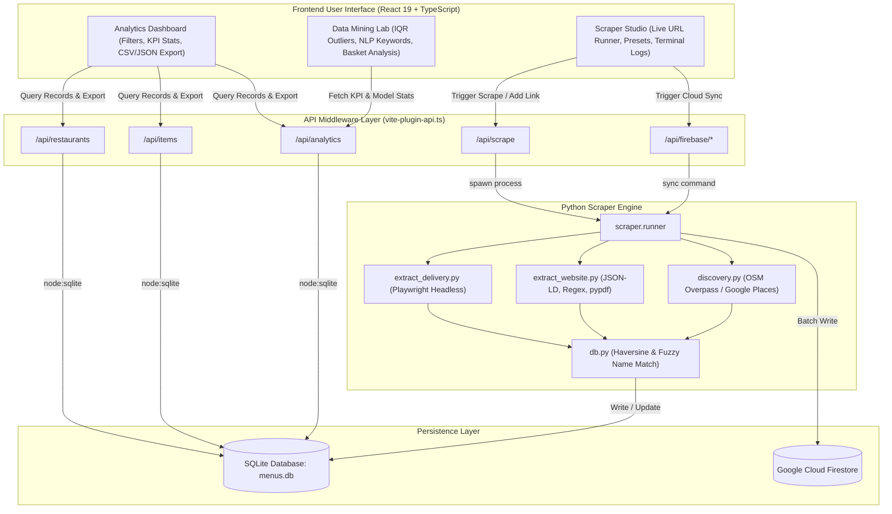

# GrabFood & Restaurant Data Scraper

[](https://react.dev/)
[](https://www.typescriptlang.org/)
[](https://vitejs.dev/)
[](https://www.python.org/)
[](https://playwright.dev/)
[](https://www.sqlite.org/)
[](https://firebase.google.com/)

> **An end-to-end restaurant venue discovery, headless delivery & web menu extraction engine, and computational data mining laboratory.**

A high-performance restaurant intelligence platform engineered to map local dining ecosystems, extract rich menu datasets from food delivery apps and official websites, and provide actionable analytics. It handles everything from automated venue discovery, headless browser menu scraping, and fuzzy geospatial deduplication to hybrid SQLite/Firestore persistence, real-time analytics, and advanced computational data mining.

---

## Table of Contents

- [Key Features](#key-features)
- [How the System Works](#how-the-system-works)
  - [Architecture Overview](#architecture-overview)
  - [The 5-Stage Scraping & Intelligence Pipeline](#the-5-stage-scraping--intelligence-pipeline)
  - [Fuzzy Deduplication & Spatial Normalization](#fuzzy-deduplication--spatial-normalization)
  - [Hybrid Storage & Cloud Synchronization](#hybrid-storage--cloud-synchronization)
- [Technologies Used](#technologies-used)
  - [Frontend Layer](#frontend-layer)
  - [Backend & Middleware Layer](#backend--middleware-layer)
  - [Scraper & Data Extraction Engine](#scraper--data-extraction-engine)
  - [Data Persistence & Cloud Services](#data-persistence--cloud-services)
  - [Testing & DevOps](#testing--devops)
- [System Architecture Diagram](#system-architecture-diagram)
- [Project Structure](#project-structure)
- [Getting Started](#getting-started)
  - [Prerequisites](#prerequisites)
  - [1. Clone & Install Frontend Dependencies](#1-clone--install-frontend-dependencies)
  - [2. Configure Python Scraper Virtual Environment](#2-configure-python-scraper-virtual-environment)
  - [3. Configure Environment Variables](#3-configure-environment-variables)
  - [4. Launch the Development Server](#4-launch-the-development-server)
- [CLI Scraper Usage (Standalone Execution)](#cli-scraper-usage-standalone-execution)
- [REST API Reference](#rest-api-reference)
- [Ethical Scraping & Rate Limiting Guidelines](#ethical-scraping--rate-limiting-guidelines)

---

## Key Features

- **Multi-Source Discovery Engine**: Automatically locates food establishments across target geographic coordinates using OpenStreetMap (Overpass API) and Google Places API (New Text Search).
- **Headless Delivery Platform Extractor**: Collects menus from delivery applications (GrabFood, foodpanda) using Playwright Chromium headless network interception to extract structured menu data without private API bypasses.
- **Smart Website Parser**: Extracts menus directly from restaurant websites using schema.org `JSON-LD` microdata, regular expressions for price matching (`RM XX.XX`), and text extraction from downloadable PDF menus (`pypdf`).
- **Geospatial & Fuzzy Deduplication**: Merges multi-source entries into a single restaurant entity using Haversine distance (<120m threshold) combined with Levenshtein/`SequenceMatcher` string similarity matching.
- **Scraper Studio**: Interactive web console with quick presets, custom parameter injection (cuisine, rating, coordinates, opening hours), live terminal execution logs, and manual venue link mapping.
- **Analytics & Dataset Filtering**: Search, filter, and sort menu items across restaurants, categories, cuisines, and price ranges with instant KPI summary cards.
- **Data Mining Lab**:
  - **Outlier & Anomaly Mining**: Dynamic Interquartile Range (IQR) boxplot calculation and anomaly detection.
  - **Culinary NLP & Text Mining**: Tokenization, stopword filtering, and frequency analysis of menu keywords.
  - **Market Basket Analysis**: Support and confidence estimation for combo items and cross-category ordering patterns.
  - **Price Distribution & Econometric Modeling**: Dynamic price histogram binning, variance, and standard deviation calculations.
- **One-Click Export & Cloud Sync**: Instant CSV/JSON dataset downloads and Google Cloud Firestore database synchronization via Firebase Admin SDK.

---

## How the System Works

### Architecture Overview

The system operates as a unified full-stack application. A React + TypeScript single-page application (SPA) communicates with an embedded Node.js API middleware inside Vite. When scraping operations are triggered from the UI, the Node API spawns isolated Python worker processes that execute headless Chromium sessions or polite HTTP crawlers, writes updates to SQLite (`menus.db`), and optionally syncs with Google Cloud Firestore.

```
+-----------------------------------------------------------------------------------+
|                                  USER BROWSER                                     |
|           [Scraper Studio]    [Analytics Dashboard]    [Data Mining Lab]          |
+-----------------------------------------+-----------------------------------------+
                                          | HTTP / JSON REST APIs
                                          v
+-----------------------------------------------------------------------------------+
|                        VITE API MIDDLEWARE (Node.js)                              |
|   /api/restaurants  |  /api/items  |  /api/analytics  |  /api/scrape  |  /api/sync|
+------------------------------------+----------------------------------------------+
                                     |
            +------------------------+------------------------+
            | Reads / Writes SQL                              | Spawns Worker Process
            v                                                 v
+--------------------------+                       +--------------------------------+
|  SQLite DB (menus.db)    |                       |      PYTHON SCRAPER RUNNER     |
| - restaurants            |                       | - runner.py / cli.py           |
| - menu_items             |<----------------------+ - extract_delivery.py          |
| - menu_assets            |   Atomic Transactions | - extract_website.py           |
| - scrape_log             |                       | - discovery.py                 |
+--------------------------+                       +----------------+---------------+
            ^                                                       |
            | Real-Time Cloud Sync                                  | Headless Browser / HTTP
            v                                                       v
+--------------------------+                       +--------------------------------+
|  Google Cloud Firestore  |                       | TARGET WEBSITES & PLATFORMS    |
| (restaurantdatascraper)  |                       | - GrabFood / foodpanda Pages   |
+--------------------------+                       | - Official Restaurant Sites    |
                                                   | - OpenStreetMap / Overpass API |
                                                   | - Google Places API            |
                                                   +--------------------------------+
```

---

### The 5-Stage Scraping & Intelligence Pipeline

#### 1. Discovery Stage
- Scans target bounding coordinates (e.g., 1Borneo Hypermall at `6.0360, 116.1297` and Alamesra at `6.0334, 116.1253`).
- Queries OpenStreetMap via Overpass API for amenities (`restaurant`, `fast_food`, `cafe`, `food_court`, `ice_cream`).
- Optionally queries the Google Places API (New) for extended venue profiles, user ratings, and official website URLs.

#### 2. Extraction Stage
- **Delivery Platforms (GrabFood & foodpanda)**: Opens target links in headless Chromium via Playwright. Listens to asynchronous network payloads (`XHR`/`fetch`), decodes internal JSON catalog structures, and recursively walks data nodes searching for name, price, and category containers.
- **Restaurant Websites**:
  1. Checks for structured schema.org `JSON-LD` markup (`Menu`, `MenuSection`, `MenuItem`).
  2. Fallback heuristic parsing: searches HTML text and downloadable PDF documents for Malaysian Ringgit currency patterns (`RM 12.90`, `MYR 8.50`).
  3. Image menus (scanned photos/flyers) are archived into `menu_assets` for optical character recognition (OCR) or manual audit.

#### 3. Deduplication & Spatial Normalization
- When a new restaurant is discovered or added, the engine prevents duplicate records:
  - Calculates the **Haversine great-circle distance** between coordinate pairs.
  - Compares venue titles with **fuzzy string similarity** (`SequenceMatcher`).
  - If a venue is within **120 meters** and has a name similarity ratio above **0.80**, records are merged rather than duplicated, preserving both direct website and delivery links.

#### 4. Full-Stack API & Integration Stage
- `vite-plugin-api.ts` intercepts `/api/*` HTTP calls directly in the Vite development and preview server.
- Uses Node.js native `node:sqlite` (`DatabaseSync`) for zero-overhead, synchronous SQL queries.
- Dynamically executes Python CLI tasks via `child_process.spawn`, piping structured stdout JSON back to the frontend.

#### 5. Analytics & Computational Data Mining Stage
- Raw database records are aggregated into actionable business intelligence:
  - **KPIs**: Mean, median, minimum, maximum, variance, and standard deviation of menu prices.
  - **Outlier Detection**: Calculates lower and upper fences using the formula:
    $$\text{Lower Bound} = \max(0, Q_1 - k \times \text{IQR}), \quad \text{Upper Bound} = Q_3 + k \times \text{IQR}$$
    where $k$ is an adjustable multiplier (default 1.5).
  - **Culinary NLP**: Tokenizes item titles, removes multi-lingual stop words (`set`, `with`, `dan`, `ala`, `carte`), and extracts top dish themes and flavor profiles.

---

### Fuzzy Deduplication & Spatial Normalization

Restaurants often appear under slightly different names across different services (e.g., *"Subway - 1Borneo"* on GrabFood vs *"Subway Restaurants"* on Google Places). The database engine uses the following deduplication logic:

1. **Exact Identifier Match**: Matches unique OSM IDs (`node/12345`) or Google Place IDs.
2. **Spatial Proximity & String Similarity**:
   - Compares physical proximity using coordinates:
     $$d = 2R \arcsin\left(\sqrt{\sin^2\left(\frac{\Delta \phi}{2}\right) + \cos(\phi_1)\cos(\phi_2)\sin^2\left(\frac{\Delta \lambda}{2}\right)}\right)$$
   - If distance $d \le 120\text{ m}$ and name similarity ratio $\ge 0.80$, the existing record is updated with any newly discovered URLs or coordinates.
3. **Menu Item Replacement**: When a restaurant is rescraped from the same source, existing menu items for that specific source are refreshed to prevent duplicate entries while preserving items scraped from complementary platforms.

---

### Hybrid Storage & Cloud Synchronization

- **Local Storage (`menus.db`)**:
  - Relational SQLite database with foreign keys enabled.
  - Tables: `restaurants`, `menu_items`, `menu_assets`, `scrape_log`.
  - Ensures full offline functionality and fast analytical queries.
- **Cloud Database (Google Cloud Firestore)**:
  - Document collections: `restaurants` and `menu_items`.
  - Authenticated through Google Cloud Service Account credentials (`GOOGLE_APPLICATION_CREDENTIALS` or `credentials/serviceAccountKey.json`).
  - Synchronized on demand from the Scraper Studio UI or via CLI:
    ```bash
    python -m scraper.runner --sync-firebase
    ```

---

## Technologies Used

### Frontend Layer

| Technology | Purpose |
|---|---|
| **React 19** | Core UI library for reactive component rendering and state management |
| **TypeScript** | Strict type definitions across UI state, API payloads, and analytical data models |
| **Vite 8** | High-performance build tool, hot module replacement (HMR), and dev server |
| **Lucide React** | Modern iconography set for navigation, status indicators, and analytical metrics |
| **Native CSS3** | Custom design system with glassmorphic cards, responsive flex/grid layouts, and theme tokens |

### Backend & Middleware Layer

| Technology | Purpose |
|---|---|
| **Node.js 20+** | Server execution environment |
| **node:sqlite** | Native synchronous SQLite database driver for low-latency queries without native binary build dependencies |
| **Vite Plugin API (`vite-plugin-api.ts`)** | Embedded middleware serving `/api/*` REST endpoints directly from Vite |
| **Child Process (`node:child_process`)** | Spawns headless Python scraper runners asynchronously and streams execution logs |

### Scraper & Data Extraction Engine

| Technology | Purpose |
|---|---|
| **Python 3.10+ / 3.12+** | Core language for the web scraping pipeline |
| **Playwright (Chromium)** | Headless browser automation for rendering dynamic JavaScript and capturing XHR network responses |
| **BeautifulSoup4** | HTML parsing, DOM traversal, and microdata/schema.org JSON-LD extraction |
| **Requests** | HTTP client equipped with custom retry policies, exponential backoff, and timeouts |
| **pypdf** | Stream reader and text parser for extracting prices from downloadable PDF menus |
| **PoliteClient** | Custom rate limiter enforcing minimum delays (2.0s per host) and `robots.txt` verification |

### Data Persistence & Cloud Services

| Technology | Purpose |
|---|---|
| **SQLite 3** | Local relational storage with cascading deletes and composite indexes |
| **Google Cloud Firestore** | Scalable NoSQL cloud document database for remote data access |
| **Firebase Admin SDK** | Node.js and Python SDKs for secure service account authentication and batch document syncing |

### Testing & DevOps

| Technology | Purpose |
|---|---|
| **Pytest** | Unit testing framework validating parsing logic, price extractors, and database schemas |
| **ESLint** | Code linting and quality enforcement for TypeScript and React |
| **Netlify (`netlify.toml`)** | Production deployment configuration with SPA routing rules |

---

## System Architecture Diagram



---

## Project Structure

```
RestaurantScraper/
├── src/                               # Frontend React Application
│   ├── api/
│   │   └── client.ts                  # Typed client for all /api endpoints
│   ├── assets/                        # Static brand assets and imagery
│   ├── components/
│   │   ├── AnalyticsDashboard.tsx     # Dataset browser, faceted filtering, export tools
│   │   ├── DataMiningLab.tsx          # Anomaly detection, NLP keyword mining, basket analysis
│   │   ├── Header.tsx                 # Navigation bar, status indicators, refresh trigger
│   │   └── ScraperStudio.tsx          # Real-time URL runner, presets, venue link manager
│   ├── utils/
│   │   └── maps.ts                    # Google Maps URL generation helpers
│   ├── App.css                        # Component stylesheets and responsive layout
│   ├── App.tsx                        # Main view router and global state coordination
│   ├── index.css                      # Global design system variables and typography
│   ├── main.tsx                       # React application root entry point
│   └── types.ts                       # TypeScript interfaces for API and data models
├── scraper/                           # Python Scraper Backend Engine
│   ├── data/
│   │   └── menus.db                   # SQLite database (auto-created on first run)
│   ├── exports/
│   │   ├── menu_items.csv             # Exported dataset in CSV format
│   │   └── restaurants.json           # Exported dataset in JSON format
│   ├── scraper/
│   │   ├── __init__.py
│   │   ├── __main__.py                # CLI entry point (python -m scraper)
│   │   ├── browser.py                 # Playwright Chromium headless lifecycle manager
│   │   ├── cli.py                     # Command-line interface definitions and subcommands
│   │   ├── config.py                  # Coordinate bounding boxes, timeouts, user-agents
│   │   ├── db.py                      # SQLite schemas, spatial matching, fuzzy deduplication
│   │   ├── discovery.py               # OpenStreetMap Overpass and Google Places discoverers
│   │   ├── extract_delivery.py        # GrabFood & foodpanda JSON response extractor
│   │   ├── extract_website.py         # JSON-LD, regex price matching, and PDF extractor
│   │   ├── firebase_db.py             # Firestore adapter and credentials manager
│   │   ├── http_client.py             # Rate-limited polite HTTP client
│   │   └── runner.py                  # Standalone CLI runner with stdout JSON formatting
│   ├── tests/
│   │   └── test_scraper.py            # Pytest test suite for parsing and database logic
│   └── requirements.txt               # Python package dependencies
├── credentials/                       # Private service account keys (gitignored)
│   └── serviceAccountKey.json         # Optional Firebase Service Account key file
├── .env.example                       # Template for local environment variables
├── AGENT.md                           # Operational guidelines and zero-knowledge privacy rules
├── netlify.toml                       # Netlify deployment and SPA rewrite rules
├── package.json                       # Node.js project manifest and scripts
├── tsconfig.json                      # TypeScript compiler configuration
├── vite.config.ts                     # Vite build configuration
└── vite-plugin-api.ts                 # Custom Vite API middleware connecting UI with SQLite/Python
```

---

## Getting Started

### Prerequisites

Ensure the following runtimes and packages are installed on your machine:
- **Node.js**: `v20.0.0` or higher (Node 22 LTS recommended)
- **npm**: `v10.0.0` or higher
- **Python**: `3.10` or higher
- **Git**

---

### 1. Clone & Install Frontend Dependencies

```bash
git clone https://github.com/ElXprogramming/Grabfood-Data-Scraper.git
cd Grabfood-Data-Scraper
npm install
```

---

### 2. Configure Python Scraper Virtual Environment

Create and activate a virtual environment inside the `scraper/` folder, then install the Python dependencies:

```bash
cd scraper
python3 -m venv .venv

# On Linux / macOS:
source .venv/bin/activate

# On Windows (PowerShell):
# .venv\Scripts\Activate.ps1

pip install -r requirements.txt
playwright install chromium
cd ..
```

> **Note**: Installing Chromium via `playwright install chromium` is required for rendering dynamic JavaScript pages and scraping delivery platforms like GrabFood.

---

### 3. Configure Environment Variables

Copy the template file `.env.example` to `.env`:

```bash
cp .env.example .env
```

Open `.env` and fill in any optional credentials:
```env
# Path to your Google Cloud / Firebase service account key (for Firestore sync)
GOOGLE_APPLICATION_CREDENTIALS="./credentials/serviceAccountKey.json"

# Optional: Google Places API Key (for Google venue discovery)
GOOGLE_PLACES_API_KEY=""

# Optional: Identify your crawler respectfully
SCRAPER_UA="RestaurantDataScraper/1.0 (+https://github.com/your-org/scraper)"
```

---

### 4. Launch the Development Server

Start the full-stack development environment:

```bash
npm run dev
```

The application will launch at:
```
http://localhost:5173
```

- Navigate to **Scraper Studio** to run on-demand scrapes or test presets.
- Open **Analytics Dashboard** to explore items, apply filters, or download CSV/JSON exports.
- Visit **Data Mining Lab** to inspect IQR anomaly thresholds, text mining token frequencies, and combo item association rules.

---

## CLI Scraper Usage (Standalone Execution)

The Python backend can also be operated independently via the command line:

```bash
# Activate the virtual environment
source scraper/.venv/bin/activate

# 1. Discover restaurants from OpenStreetMap or Google Places
python -m scraper discover --source osm
python -m scraper discover --source google

# 2. Scrape restaurant websites found during discovery
python -m scraper scrape

# 3. Scrape a specific restaurant with dynamic Chromium rendering
python -m scraper scrape --only "Subway" --render

# 4. Attach a GrabFood or foodpanda delivery URL to a restaurant
python -m scraper add-link "Subway Alamesra" "https://food.grab.com/my/en/restaurant/subway-alamesra-delivery/1-C7C2CTJFVCJVA6?"

# 5. Extract menu items from attached delivery links
python -m scraper delivery --only "Subway"

# 6. Display database statistics in the terminal
python -m scraper stats

# 7. Export the database to CSV and JSON files in scraper/exports/
python -m scraper export

# 8. Run unit test suite
PYTHONPATH=scraper scraper/.venv/bin/pytest scraper/tests
```

---

## REST API Reference

The Vite API middleware (`vite-plugin-api.ts`) exposes the following endpoints:

| Endpoint | Method | Description | Parameters / Payload |
|---|---|---|---|
| `/api/restaurants` | `GET` | Fetches all restaurants with item counts and price aggregations | None |
| `/api/items` | `GET` | Queries menu items with faceted filtering and pagination | Query: `restaurant_id`, `search`, `category`, `cuisine`, `min_rating`, `area`, `min_price`, `max_price`, `sort`, `limit`, `offset` |
| `/api/analytics` | `GET` | Computes statistical KPIs, price bins, top categories, NLP keywords, and IQR outliers | None |
| `/api/scrape` | `POST` | Dispatches the headless scraper to extract a given URL | Body: `{ url, name, rating, cuisine, opening_hours, address, lat, lon, area, render }` |
| `/api/add-link` | `POST` | Maps a delivery or website link to a restaurant with automatic deduplication | Body: `{ name, url, address, lat, lon, rating, cuisine, opening_hours }` |
| `/api/update-restaurant` | `POST` | Updates metadata for an existing restaurant entity | Body: `{ id, name, rating, cuisine, opening_hours, address, lat, lon, area }` |
| `/api/export` | `GET` | Streams dataset file directly to browser | Query: `format=csv` (default) or `format=json` |
| `/api/firebase/status` | `GET` | Checks if Firestore credentials are configured | None |
| `/api/firebase/sync` | `POST` | Initiates two-way sync from SQLite to Google Cloud Firestore | None |

---

## Security Architecture & Rate Limiting Controls

The system features multi-layered defensive security measures across both the Node.js API middleware and Python backend:

### 1. Multi-Tiered Rate Limiting & Concurrency Controls
- **Sliding-Window In-Memory Limiter**:
  - **Scrape & Sync Tier** (`/api/scrape`, `/api/firebase/sync`): **10 requests / 60 seconds** per IP.
  - **Mutation Tier** (`/api/add-link`, `/api/update-restaurant`): **30 requests / 60 seconds** per IP.
  - **Read & Analytics Tier** (`/api/restaurants`, `/api/items`, `/api/analytics`, `/api/export`): **120 requests / 60 seconds** per IP.
  - Responds with `HTTP 429 Too Many Requests` and standard RFC rate-limit headers (`X-RateLimit-Limit`, `X-RateLimit-Remaining`, `X-RateLimit-Reset`, `Retry-After`).
  - Automatic background pruning of expired IP records to prevent memory leaks.
- **Process Concurrency Semaphore**: Restricts simultaneous headless Chromium / scraper jobs to **2 concurrent processes** system-wide, preventing CPU/RAM exhaustion and OOM crashes.

### 2. Server-Side Request Forgery (SSRF) Defense
- **Protocol Allowlist**: Restricts input target URLs exclusively to `http:` and `https:`.
- **IP & Host Blacklisting**: Validates and blocks loopback addresses (`127.0.0.0/8`, `localhost`, `::1`), private networks (RFC 1918: `10.0.0.0/8`, `172.16.0.0/12`, `192.168.0.0/16`), and link-local / cloud metadata services (`169.254.0.0/16`, `metadata.google.internal`).
- Enforced at both the Node API middleware layer and the Python crawler (`PoliteClient`, `runner.py`).

### 3. CLI Argument & Command Injection Defense
- All parameters dispatched to Python child processes are sanitized (`sanitizeText`).
- Rejects leading hyphens (`-`, `--`) that could be misparsed by CLI argument parsers.
- Strict numeric boundary validation on ratings (`[0, 5]`) and geographic coordinates (`lat: [-90, 90]`, `lon: [-180, 180]`).

### 4. Payload Size Limits & DoS Prevention
- Request bodies are capped at **256 KB** (`MAX_BODY_SIZE`). Oversized requests trigger `HTTP 413 Payload Too Large`.
- Unparseable or malformed JSON payloads return `HTTP 400 Bad Request`.
- Python child process execution is guarded by a **90-second timeout**, terminating lingering processes via `SIGTERM` / `SIGKILL`.

### 5. CSV Formula Injection (DDE) Neutralization
- Cell values starting with spreadsheet formula triggers (`=`, `+`, `-`, `@`, `\t`, `\r`) are automatically escaped with a leading single quote (`'`), ensuring spreadsheet software (Excel, LibreOffice, Google Sheets) interprets exported data strictly as plain text.

### 6. Defensive HTTP Security Headers
- Every API response is served with:
  - `X-Content-Type-Options: nosniff`
  - `X-Frame-Options: DENY`
  - `X-XSS-Protection: 1; mode=block`
  - `Referrer-Policy: strict-origin-when-cross-origin`
  - `Permissions-Policy: camera=(), microphone=(), geolocation=()`
  - `Cache-Control: no-store, no-cache, must-revalidate, proxy-revalidate, max-age=0`
  - Defensive CORS restricting origin access.

### 7. Automated Security Test Suites
Run the automated test suites verifying all security controls:

```bash
# Run both Node.js API security tests and Python scraper tests
npm run test:all

# Run Node.js security & rate limiting tests (27 tests)
npm test

# Run Python security, SSRF & scraper tests (20 tests)
npm run test:python
```

---

## License

This project is open-source under the [MIT License](LICENSE).
